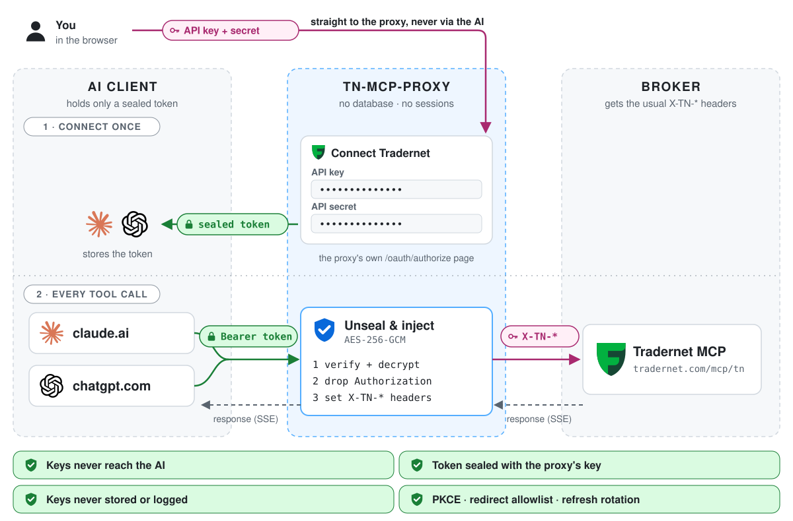

# tn-mcp-proxy

An OAuth 2.1 facade in front of header-authenticated MCP servers. The Tradernet
MCP (`https://tradernet.com/mcp/tn`) authenticates with static request headers
(`X-TN-API-Key`, `X-TN-API-Secret`, optionally `X-TN-SID`), which claude.ai
and ChatGPT custom connectors cannot send; they only speak OAuth. tn-mcp-proxy
sits between the two: it presents a standard OAuth authorization server to
claude.ai or ChatGPT and forwards MCP traffic to the upstream with the user's
headers attached.

tn-mcp-proxy does not implement the Tradernet API itself: it fronts Tradernet's
own [MCP server](https://tradernet.com/tradernet-api/mcp) and forwards MCP
traffic to it with the user's credential headers attached.

> [!CAUTION]
> **A public proxy that accepts any upstream credentials is an open relay from
> your IP.** Every request to Tradernet leaves from this server's IP address, and
> the upstream tools can trade on the account (place and cancel orders) and read
> the portfolio and balances. Anyone with valid Tradernet credentials, stolen or
> their own, can obtain a token and act through your server. The activity
> originates from your server's IP, so in a broker, exchange or police inquiry it
> points to you, the operator.
>
> Strongly recommended: restrict the server to your own keys with
> `allowed_values` on the non-secret credential, together with `validate` (the
> allow-list is rejected at startup without it) and `forbidden_arguments`:
>
> ```yaml
> credentials:
>   - { header: X-TN-API-Key, label: API key, allowed_values: ["REPLACE_WITH_YOUR_API_KEY"] }
>   - { header: X-TN-API-Secret, label: API secret, secret: true }
>   - { header: X-TN-SID, label: SID, optional: true }
> validate: { tool: get_auth_info }
> forbidden_arguments: [api_key, api_secret]
> ```
>
> Otherwise keep the proxy private (VPN, firewall or IP allow-list in front of
> it). The proxy logs a startup warning for every upstream without an allow-list.
> See [Restricting access](docs/configuration.md#restricting-access).

<picture>
  <source media="(prefers-color-scheme: dark)" srcset="docs/images/flow-dark.svg">
  
</picture>

## How it works

1. claude.ai or ChatGPT discovers the OAuth endpoints (`/.well-known/*`),
   registers itself (dynamic client registration) and sends the user to
   `/oauth/authorize`.
2. The user types their Tradernet credentials into a form served by the proxy.
3. The proxy encrypts the credentials into the access and refresh tokens it
   issues (AES-256-GCM, keys from your config). There is no database or persistent
   state; only bounded in-memory replay caches.
4. On each MCP request the AI client sends the token; the proxy opens it, sets
   the credential headers and streams the request to the upstream (SSE supported).

Who sees what:

| | Plain API keys | Sealed token |
| --- | --- | --- |
| You | type them once on the proxy's page | - |
| claude.ai / ChatGPT | never | stores it, cannot decrypt it |
| tn-mcp-proxy | in memory, per request; never stored or logged | opens it with keys from your config |
| Tradernet MCP | in the `X-TN-*` headers, as with a direct call | - |

The token is a bearer secret: whoever holds it can use it until it expires (access tokens: `oauth.access_token_ttl`; a refresh chain: its idle expiry or `oauth.max_session_ttl`, whichever comes first, and nothing is revoked when a connector is disconnected).
A TLS-terminating reverse proxy in front of tn-mcp-proxy also sees the plain
keys while you submit the authorization form.

See [docs/architecture.md](docs/architecture.md) for the details.

## Install

### From a GitHub Release

Archives are published per release for `linux` and `darwin` on `amd64` and
`arm64`: `tn-mcp-proxy_<version>_<os>_<arch>.tar.gz` (version without the `v`
prefix), plus `checksums.txt` (sha256).

```sh
VERSION=X.Y.Z   # replace with a release from the Releases page
OS=linux ARCH=amd64
BASE=https://github.com/zigmund/tn-mcp-proxy/releases/download/v${VERSION}
curl -fsSLO ${BASE}/tn-mcp-proxy_${VERSION}_${OS}_${ARCH}.tar.gz
curl -fsSLO ${BASE}/checksums.txt
sha256sum --ignore-missing -c checksums.txt      # macOS: shasum -a 256 --ignore-missing -c checksums.txt
tar xzf tn-mcp-proxy_${VERSION}_${OS}_${ARCH}.tar.gz
sudo install -m 0755 tn-mcp-proxy_${VERSION}_${OS}_${ARCH}/tn-mcp-proxy /usr/local/bin/
tn-mcp-proxy -version
```

The archive also contains `deploy/` (example config, systemd unit), the `docs/*.md`
files, `README.md` and `LICENSE`.

### From source

```sh
git clone https://github.com/zigmund/tn-mcp-proxy && cd tn-mcp-proxy
make build            # binary in bin/
sudo install -m 0755 bin/tn-mcp-proxy /usr/local/bin/
```

(`go install github.com/zigmund/tn-mcp-proxy/cmd/tn-mcp-proxy@latest` also
works but puts the binary in `$GOPATH/bin` and reports the version `dev`; copy
it to `/usr/local/bin/`.)

## Configure

Create `/etc/tn-mcp-proxy/config.yaml` (full reference:
[docs/configuration.md](docs/configuration.md), annotated example:
[deploy/config.example.yaml](deploy/config.example.yaml)):

```yaml
listen: 127.0.0.1:8787
public_url: https://mcp.example.com     # origin only, no path
secrets:
  token_keys_file: /run/credentials/tn-mcp-proxy.service/keys
upstreams:
  - name: tn
    title: Tradernet
    path: /tn/mcp
    url: https://tradernet.com/mcp/tn
    credentials:
      - { header: X-TN-API-Key,    label: API key }
      - { header: X-TN-API-Secret, label: API secret, secret: true }
      - { header: X-TN-SID,        label: SID, optional: true }
    validate: { tool: get_auth_info }   # check the keys with Tradernet before issuing a token
```

To accept only your own API key, apply the `allowed_values` and
`forbidden_arguments` lines from the warning above (see
[Restricting access](docs/configuration.md#restricting-access)).

Generate the token key (base64 of 32 random bytes) into a root-only file, one
key per line:

```sh
sudo install -d -m 0755 /etc/tn-mcp-proxy
openssl rand -base64 32 | sudo install -m 0600 -o root -g root /dev/stdin /etc/tn-mcp-proxy/keys
```

Install the config so the service can read it but other local users cannot.
If the service runs as a dedicated user and group (for example via `User=` and
`Group=` in a drop-in), use `0640` with that group:

```sh
sudo install -m 0640 -o root -g tn-mcp-proxy config.yaml /etc/tn-mcp-proxy/config.yaml
```

With the bundled unit's `DynamicUser=` there is no fixed group to grant, so the
simplest setup is `0644`, root-owned (`sudo install -m 0644 -o root -g root ...`).
That exposes the file to every local user of the host, including any
`allowed_values` entry (your API key); prefer the dedicated group when other
people have shell access.

Keep the keys out of `config.yaml`: the bundled systemd unit delivers the file
to the service through `LoadCredential=`, and the config points at it by its
absolute path (`/run/credentials/tn-mcp-proxy.service/keys`; environment
variables are not expanded in the config). The config itself then holds no
secrets, which is what makes `0644` tolerable. Anyone with the keys can decrypt every issued token,
so treat them like passwords.

## Run

The systemd unit lives in [deploy/](deploy/). Run the commands from
the extracted release archive directory or a checkout. The unit needs systemd
247 or newer (`LoadCredential=` with `DynamicUser=`).

```sh
sudo install -m 0644 deploy/tn-mcp-proxy.service /etc/systemd/system/
sudo systemctl daemon-reload
sudo systemctl enable --now tn-mcp-proxy
curl -fsS http://127.0.0.1:8787/healthz
journalctl -u tn-mcp-proxy -f
```

Options: `-config <path>` (default `/etc/tn-mcp-proxy/config.yaml`), `-version`, `-h`.
`SIGTERM`/`SIGINT` shut down gracefully; `SIGHUP` reloads the TLS certificate
when built-in TLS is enabled (the unit's `ExecReload` sends it) and is otherwise a no-op.

## Reverse proxy

The service listens on plain HTTP by default, so terminate TLS in front of it.
Alternatively set `tls.cert_file`/`tls.key_file` to serve HTTPS directly, with
certificate hot reload (see [Built-in TLS](docs/configuration.md#built-in-tls)). An
example nginx snippet (no buffering, long timeouts, `X-Forwarded-For` overwrite, optional
extra rate limit for `/oauth/`) is in [docs/configuration.md](docs/configuration.md#reverse-proxy).
`GET /healthz` returns 200 and is meant for local checks.

## Get Tradernet API keys

Log in to Tradernet and generate an API key pair at
<https://tradernet.com/tradernet-api/auth-api>. You will enter the API key and
API secret (and optionally a SID) on the proxy's authorization page when you
connect. The proxy does not store them (they live only inside the sealed token
your AI client holds), but they do pass through the proxy process, so run the
proxy yourself or use one whose operator you trust.

## Connect claude.ai

1. In claude.ai: Settings -> Connectors -> Add custom connector.
2. URL: `public_url` + the upstream `path`, e.g. `https://mcp.example.com/tn/mcp`.
3. Connect. The browser opens the proxy's authorization page for the upstream:
   enter your Tradernet API key, API secret and (if you use one) SID.
4. Submit. With `validate` configured, the proxy first checks the keys with
   Tradernet and shows the form again if they are rejected. Otherwise claude.ai
   receives tokens and the connector is ready.

Your credentials are not stored on the server. They are sealed (encrypted and
authenticated) inside the tokens that claude.ai holds, and are decrypted only
to attach them to the request being forwarded.

If the keys are later revoked, Tradernet does not answer `401`: it answers
HTTP `200` with a tool error, so the connector would stay "connected" while
every tool call fails. `validate.recheck_on_tool_error: true` (enabled in the
example config) makes the proxy re-run the `validate` check on a tool error and
answer `401 invalid_token` only if the keys are really rejected, so claude.ai
re-runs the flow and you can enter new keys; other tool errors pass untouched.
See [docs/configuration.md](docs/configuration.md#re-check-on-tool-errors).
An upstream that does answer `401` is handled without any configuration.

## Connect ChatGPT

The UI path below may change; follow the current ChatGPT documentation if it differs.

1. In ChatGPT: Settings -> Apps & Connectors -> Advanced -> enable Developer mode.
2. Create a connector (custom app) with the MCP server URL: `public_url` + the
   upstream `path`, e.g. `https://mcp.example.com/tn/mcp`. Choose OAuth as the
   authentication method.
3. Connect. The browser opens the same authorization page: enter your upstream
   credentials and submit.

ChatGPT registers itself through dynamic client registration and uses the stable
redirect URI `https://chatgpt.com/connector_platform_oauth_redirect`, which is
allowed by default and relies on the RFC 9207 `iss` parameter the proxy
returns. Credentials are handled as described above.

## Key rotation

1. Generate a new key and put it first in the keys file; keep the old one below it:
   ```sh
   sudo sh -c 'umask 077; { openssl rand -base64 32; cat /etc/tn-mcp-proxy/keys; } > /etc/tn-mcp-proxy/keys.new && mv /etc/tn-mcp-proxy/keys.new /etc/tn-mcp-proxy/keys'
   sudo systemctl restart tn-mcp-proxy    # reload does not re-read keys
   ```
   (`umask 077` makes the new file `0600` from the start.)
2. The first key seals new tokens; all listed keys still open existing ones, so
   no one is logged out. Every refresh issues a new refresh token with a fresh (sliding)
   `refresh_token_ttl` (capped at `oauth.max_session_ttl` from the original login), so
   active connectors migrate to the new key by themselves.
3. After `oauth.refresh_token_ttl` (default 720h = 30 days; logins older than
   `oauth.max_session_ttl`, default 90 days, are cut off earlier) no token sealed
   with the old key is still valid. Remove the old key and restart. Registered client
   ids sealed with the old key become invalid too, and refresh tokens are bound
   to the old client id, so this step is not seamless: claude.ai re-registers on
   its own, but every user must go through the credentials form again. Connectors
   idle for longer than the TTL must be reconnected as well.

If a key leaked: add a new key first (first in the file), then remove the
leaked one and restart. Removing a key invalidates every token AND every
registered client id sealed with it, so claude.ai re-registers and users have
to reconnect the connector. Do not rely on a plain restart to cut off a leak
(see the note on restarts under Security notes).

## Security notes

The threat model and mechanisms are in
[docs/architecture.md](docs/architecture.md#security-considerations); the
reports of the independent security audits are indexed in
[docs/security/](docs/security/README.md).

- No database or stored credentials; tokens are self-contained sealed blobs.
  Anyone with the token keys can decrypt every issued token.
- The host sees credentials in plaintext on the authorize form: run the proxy
  only on a host you trust, always behind TLS, and keep `public_url` on `https`
  (enforced: `http` is accepted only for loopback or with
  `allow_insecure_http`; the same goes for redirect URIs and upstream URLs).
  Known-weak token keys, including the old example key, are rejected at startup.
- Set `validate` on every upstream: without it the form accepts any values and
  anyone who can reach the server could mint a token and use it as a relay.
  With it, a code is issued only for credentials the upstream accepts (the check
  is read-only, fails closed and never follows redirects; see
  [docs/configuration.md](docs/configuration.md#credential-validation)).
- Restrict who can use an upstream with `allowed_values` on a non-secret
  credential (for example your own API key), together with `validate` and
  `forbidden_arguments` (see the warning at the top). Credentials outside the
  list get no token, and existing tokens stop working once a value is removed.
  Without a list, anyone with valid upstream credentials can use the server (and
  its IP) and the proxy logs a startup warning. See
  [docs/configuration.md](docs/configuration.md#restricting-access).
- Running open to anyone's keys? Enable the opt-in audit log (`audit.enabled`,
  with `audit: true` on the identifying credential) so you can answer "who used
  account X through this IP, and when". See
  [docs/configuration.md](docs/configuration.md#audit-log).
- The authorize page speaks English, Russian and Kazakh (the user's browser
  language, or `?lang=`), and can show your own notice and an optional terms of
  use the user must accept (`oauth.page.terms`, with sample agreements in
  `deploy/`). See
  [docs/configuration.md](docs/configuration.md#languages-and-terms-of-use).
- Run a single instance. Single-use authorization codes and refresh-token
  families are tracked in bounded in-memory caches, so several instances would
  not see each other's usage.
- A restart resets replay protection. An authorization code can be redeemed again
  within `oauth.code_ttl` (PKCE still binds it to the client), a small window. A
  refresh token consumed before a restart is accepted again (its family is
  forgotten) for up to `oauth.refresh_token_ttl`. Avoid casual restarts after a
  suspected token leak; rotate keys instead (above).
- Refresh tokens are single-use and rotated on every refresh; presenting an
  already used one revokes its whole chain (the user reconnects). A login also
  has an absolute lifetime, `oauth.max_session_ttl` (default 2160h = 90 days)
  from the original login, which refreshing never extends. Disconnecting a
  connector in claude.ai or ChatGPT revokes nothing on the proxy (there is no
  revocation endpoint): its chain stays valid until its idle expiry or the
  session cap, whichever comes first. To cut everyone off, rotate the token keys
  and remove the old one.
- Registration is open, so anyone can register a client with any `client_name`,
  including a look-alike of a known one. The authorize page therefore names the
  application by the host it returns to (`<host> is requesting access to ...`),
  shows the self-declared name only as a secondary line labelled
  "unverified", and only allowlisted redirect URIs are accepted. Check the host
  before entering credentials, and only continue if you started the connection
  yourself: an authorize link can be forwarded to someone else.
- Rate limits: the OAuth endpoints are limited per client IP by the app itself
  (`oauth.rate_limit`, with a global ceiling on code issuance), and the proxied
  MCP paths have their own rate, concurrency and body limits (`limits`). Excess
  requests get `429` with `Retry-After`, or `503` for the global in-flight cap.
  The client IP honours `X-Forwarded-For` only from `trusted_proxies` (loopback
  by default; add your CDN or load balancer there). See
  [docs/configuration.md](docs/configuration.md#rate-limiting) and
  [Proxy limits](docs/configuration.md#proxy-limits).
- Upstream traffic ignores `HTTP_PROXY`/`HTTPS_PROXY`, so credential headers are
  never sent through an environment proxy.
- Tokens, credentials and query strings are never logged.
- The service runs as a dynamic unprivileged user under a restrictive systemd
  sandbox.

## Development

```sh
make build                # binary in bin/ (version from git describe)
make test                 # go test -race ./... (fuzz seed corpora run as ordinary tests)
make vet                  # go vet ./...
make lint                 # golangci-lint, or go vet when it is not installed
make fmt                  # gofmt -w .
make test-scripts         # tests of scripts/next-version.sh
make fuzz FUZZTIME=30s    # run every fuzz target in turn, FUZZTIME each (default 30s)
```

`make build-linux` cross-compiles a static linux/amd64 binary and `make clean`
removes `bin/`. A full `make fuzz` runs the targets one after another, so it
takes (number of targets) x `FUZZTIME` plus build time.
`make fuzz` discovers every `func FuzzXxx(*testing.F)` in the `_test.go` files,
so new targets need no Makefile change. The targets cover token sealing, bearer
and client-authentication parsing, PKCE, redirect construction, the
`/oauth/authorize` and `/oauth/token` handlers, proxy authentication, and the
parsers for upstream tool errors, `Accept-Encoding` and credential-check
responses. A failing input is saved as
`testdata/fuzz/<FuzzName>/<hash>` next to the package. Fix the bug, then commit
that file as a regression seed: `go test` replays it from then on. Fuzzing is
not part of CI or the release workflow.

## Releasing

Releases are cut from `main` by a GitHub Actions workflow; see
[docs/releasing.md](docs/releasing.md).

## Documentation

- [docs/configuration.md](docs/configuration.md): every config key, limits, logging, TLS, reverse proxy
- [docs/architecture.md](docs/architecture.md): OAuth flow, proxying, token sealing, server lifecycle
- [docs/releasing.md](docs/releasing.md): cutting a release
- [docs/security/](docs/security/README.md): security reports

## License

MIT, see [LICENSE](LICENSE).
